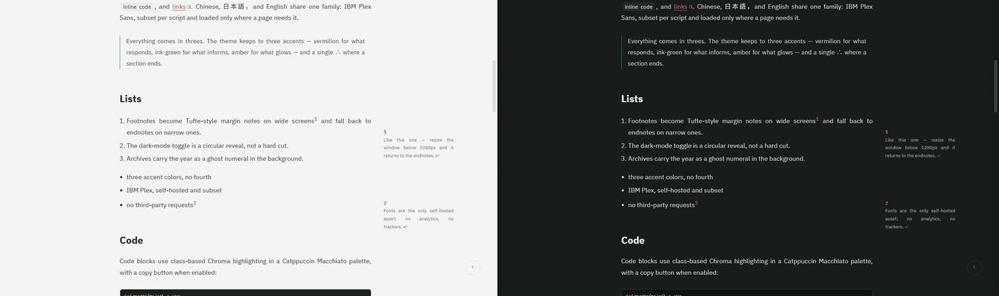

# hugo-theme-sigil

**[English](README.md)** | [中文](README.zh.md) | 日本語

<p>
  
  
</p>

[Hugo](https://gohugo.io/) 向けの控えめな文学系テーマです。
[PaperMod](https://github.com/adityatelange/hugo-PaperMod) をベースにしています。

デモ：<https://ouatis.com/hugo-theme-sigil/>



**[Hugo Extended](https://gohugo.io/installation/) ≥ 0.166.0 が必要です**
（OG カード生成に `images.Text` を使うため、extended ビルドが必須）。

> 上部のバージョンバッジは最新の**タグ**を反映します。各タグの内容はタグメッセージ自体に記録しています（`git tag -l -n20`）。

## 特徴

- ワイド画面の Tufte 風サイドノートと狭い画面の脚注
- Ghost-year 年別アーカイブ
- 円形リビール式ダークモード
- 全文 RSS
- IBM Plex と CJK フォントサブセット
- JSON Feed 1.1(`/feed.json`、RSS と並存、ビルド時に自動生成)
- 47 言語のインターフェース、右横書き対応——RTL サイト（ar/fa/he/ckb）は `direction = "rtl"` の宣言でレイアウト全体を鏡像化（サイドノートと浮遊目次を含む）
- 検索、分類、タグ、パンくず、目次、コードコピー、多言語文字列
- ページ単位で有効化:KaTeX 数式(同梱)、Mermaid 図(固定版 CDN)、画像ライトボックス(glightbox、同梱)
- 記事タイトルから OG 画像カードを自動生成(`images.Text`、ビルド時のみ)
- 外部リンクの扉マークはレンダーフックがホスト名で判定(ドメイン直書きなし)
- `llms.txt`(任意で `llms-full.txt`)— AI エージェント向けの機械可読サイトインデックス
- メンテナとエージェントは [AGENTS.md](AGENTS.md) へ:ビルド/検証コマンドと既知の落とし穴。`scripts/check.sh` が一回きりの検証

## インストール

git サブモジュールとして：

```bash
git submodule add https://github.com/ouatis/hugo-theme-sigil themes/hugo-theme-sigil
```

```toml
# hugo.toml
theme = "hugo-theme-sigil"
```

または [Hugo モジュール](https://gohugo.io/hugo-modules/) として：

```bash
hugo mod init github.com/you/your-site   # サイトに既に go.mod があれば不要
```

```toml
# hugo.toml
[module]
  [[module.imports]]
    path = "github.com/ouatis/hugo-theme-sigil"
```

サンプルサイトのプレビュー：

```bash
git clone https://github.com/ouatis/hugo-theme-sigil
cd hugo-theme-sigil/exampleSite
hugo server --themesDir ../..
```

## 設定

[デモのドキュメント](https://ouatis.com/hugo-theme-sigil/docs/) がコピー＆ペースト用の
ガイドです。ホーム設定、検索、機械可読出力、ページ機能、フォント、実測性能を説明します。

まず[設定例](https://ouatis.com/hugo-theme-sigil/config-example/)を確認し、完全なサイト
パラメータ、front matter のスイッチ、CSS フック、拡張ポイントは
[API 契約](docs/api.md)で調べてください。動作する設定全体は
[exampleSite/hugo.toml](exampleSite/hugo.toml)にもあります。

オプション機能はすべて必要なときだけ有効になります。数式、Mermaid、ライトボックスを
要求しないページは、それらのアセットを読み込みません。

## 安定性

公開契約——パラメータ名、`sg-*` クラス名、出力フォーマット、データ構造、
拡張 partial——は **v0.12.0 で凍結**：改名には非推奨期間を設け、削除はメジャー
リリースまで待ちます。契約の全文と非推奨ポリシーは
[docs/api.md](docs/api.md) を参照。両インストール方式（submodule と Hugo
module）は CI で検証されています。

## 翻訳

同梱の 47 言語は大部分が機械補完です。母語話者による修正を歓迎します——`i18n/*.yaml` のみを変更した issue / PR をどうぞ;新しいキーはまず `en` に入り、他言語はフォールバックします。

## ライセンス

MIT。詳細は [LICENSE](LICENSE) を参照してください。

PaperMod ベース。フォントは IBM Plex（SIL OFL 1.1）、アイコンは Phosphor
Icons（MIT）、検索は Fuse.js（Apache-2.0）、数式は KaTeX（MIT、同梱）、
ライトボックスは glightbox（MIT、同梱）、図は Mermaid（MIT、必要なページのみ固定版 CDN）。
