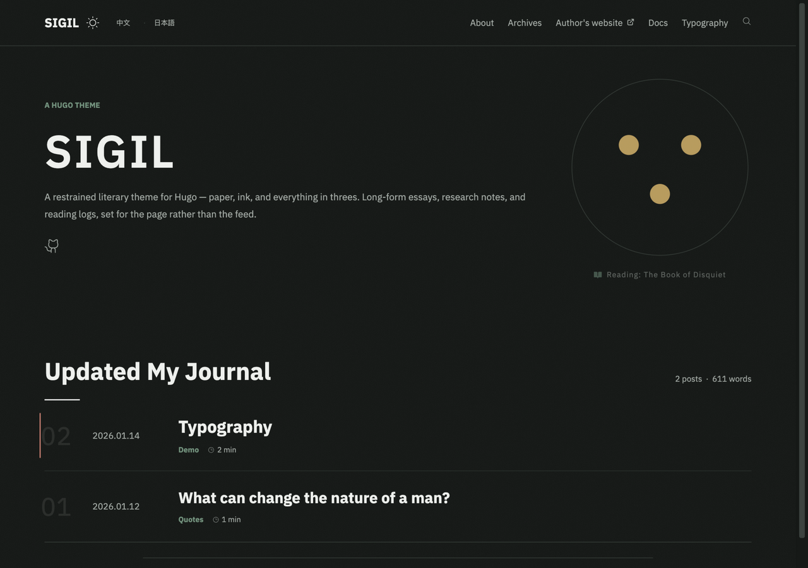

# SIGIL

**English** | [中文](README.zh.md) | [日本語](README.ja.md)

*Ink, paper, and everything in threes.*

<p>
  <a href="https://ouatis.com/hugo-theme-sigil/">
    
  </a>
  
  
  
</p>

A restrained literary theme for [Hugo](https://gohugo.io/), based on
[PaperMod](https://github.com/adityatelange/hugo-PaperMod).



**Requires [Hugo Extended](https://gohugo.io/installation/) ≥ 0.166.0**
(the theme uses `images.Text` for OG cards, which needs the extended build).

> The version badge above reflects the latest **tag**; each tag
> message carries its own notes (`git tag -l -n20`).

## Core Features

- **Three-ink typesetting on old paper** — vermilion, ink-green and amber, each carrying a fixed role rather than decorating
- **Circular-reveal dark mode** via the View Transitions API — the toggle expands as an ink blot from the button, not a whole-page fade
- **Zero-config Tufte sidenotes** — at `>=1280px` footnotes are cloned into the right margin automatically; narrow screens fall back to endnotes. No shortcodes, no per-post flags
- **Cinnabar seal and a three-state status bar** — the homepage `∴` seal sits beside a rotating Reading / Playing / Motto strip (plus Listening / Watching / Writing / Exploring, all optional)
- **Ghost-year archives** — years as watermarked ghosts in the margin, numbered entries counted oldest-first
- **IBM Plex built in**, with a CJK subsetting pipeline (`build-fonts`) that ships only the characters your corpus actually uses — reusable from CI as `ouatis/hugo-theme-sigil/.github/workflows/fonts.yml` (workflow_call, `mode` input)
- **Full-text RSS** and JSON Feed 1.1 (`/feed.json`) generated at build
- **Client-side search** (Fuse.js, vendored) with a JSON index — no external service
- **47 interface languages, right-to-left aware** — RTL sites (ar/fa/he/ckb) mirror the full layout, sidenotes and floating TOC included, via logical properties and `direction = "rtl"`
- **Opt-in per page**: KaTeX math (vendored), Mermaid diagrams (Pele engine, vendored), image lightbox (glightbox, vendored) — nothing loads on pages that don't ask
- **Auto-generated OG card images** from post titles (`images.Text`, build-time only)
- **External-link door markers** via a render hook — host-aware, no hardcoded domains
- **`llms.txt` / `llms-full.txt`** — a machine-readable site index for AI agents
- Maintainers and agents: see [AGENTS.md](AGENTS.md) for build/verify commands and pitfalls; `scripts/check.sh` is the one-shot verification

## Install

As a git submodule:

```bash
git submodule add https://github.com/ouatis/hugo-theme-sigil themes/hugo-theme-sigil
```

```toml
# hugo.toml
theme = "hugo-theme-sigil"
```

Or as a [Hugo module](https://gohugo.io/hugo-modules/):

```bash
hugo mod init github.com/you/your-site   # skip if the site already has go.mod
```

```toml
# hugo.toml
[module]
  [[module.imports]]
    path = "github.com/ouatis/hugo-theme-sigil"
```

Preview the example site:

```bash
git clone https://github.com/ouatis/hugo-theme-sigil
cd hugo-theme-sigil/exampleSite
hugo server --themesDir ../..
```

## Configuration

The [demo documentation](https://ouatis.com/hugo-theme-sigil/docs/) is the
copy-paste guide. It covers homepage settings, search, machine-readable output,
optional page features, fonts, and measured performance.

Start with the [configuration example](https://ouatis.com/hugo-theme-sigil/config-example/),
then use the [API contract](docs/api.md) for the complete list of site
parameters, front-matter switches, CSS hooks, and extension points. The working
configuration is also in [exampleSite/hugo.toml](exampleSite/hugo.toml).

Every optional feature is opt-in. A page that does not request math, Mermaid, or
the lightbox loads none of those assets.

## Stability

The public contract — parameter names, `sg-*` classes, output formats, data
shapes, extension partials — is **frozen as of v0.12.0**: renames require a
deprecation window and removals wait for a major release. The full contract
and deprecation policy live in [docs/api.md](docs/api.md). Both install modes
(submodule and Hugo module) are exercised in CI.

## Translations

The 47 bundled languages are largely machine-completed. Fixes from native
speakers are very welcome — open an issue or a PR touching `i18n/*.yaml`
only; new keys land in `en` first and fall back everywhere else.

## License

MIT. See [LICENSE](LICENSE).

Based on PaperMod. Fonts: IBM Plex, SIL OFL 1.1. Icons: Phosphor Icons, MIT.
Search: Fuse.js, Apache-2.0. Math: KaTeX, MIT (vendored). Lightbox: glightbox,
MIT (vendored). Diagrams: Mermaid syntax drawn by
Pele, MIT (vendored).
