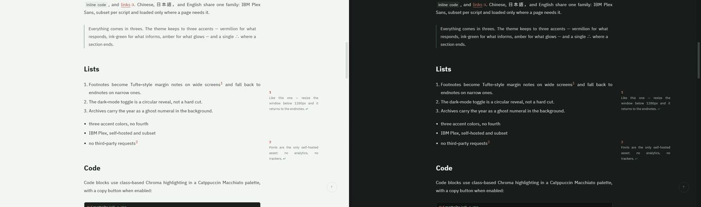

# hugo-theme-sigil

**[English](README.md)** | 中文 | [日本語](README.ja.md)

<p>
  
  
</p>

一个面向 [Hugo](https://gohugo.io/) 的克制型文学主题，基于
[PaperMod](https://github.com/adityatelange/hugo-PaperMod)。

演示站：<https://ouatis.com/hugo-theme-sigil/>



**需要 [Hugo Extended](https://gohugo.io/installation/) ≥ 0.166.0**
（主题用 `images.Text` 生成 OG 卡片，需要 extended 构建）。

> 上方版本徽标反映的是最新**标签**；每个 tag 的说明就写在 tag 信息里（`git tag -l -n20`）。

## 特性

- 宽屏 Tufte 风格旁注，窄屏自动转为尾注
- Ghost-year 年份归档
- 圆形展开式暗色模式切换
- RSS 输出全文
- IBM Plex 字体与 CJK 字体子集
- JSON Feed 1.1(`/feed.json`,与 RSS 并存,构建期自动生成)
- 47 门界面语言，右到左感知——RTL 站点（ar/fa/he/ckb）声明 `direction = "rtl"` 后整体镜像布局，含旁注与悬浮目录
- 搜索、分类、标签、面包屑、目录、代码复制和多语言字符串
- 页面级可选:KaTeX 数学(已同捆)、Mermaid 图表(定版 CDN)、图片灯箱(glightbox,已同捆)
- 用文章标题自动生成 OG 卡片图(`images.Text`,仅构建期)
- 外链门形记号由渲染钩子按主机名判定,不写死任何域名
- `llms.txt`(可选 `llms-full.txt`)——面向 AI Agent 的机器可读站点索引
- 维护者与 Agent 请读 [AGENTS.md](AGENTS.md):构建/验证命令与已知坑;`scripts/check.sh` 是一条命令的完整验证

## 安装

以 git 子模块安装：

```bash
git submodule add https://github.com/ouatis/hugo-theme-sigil themes/hugo-theme-sigil
```

```toml
# hugo.toml
theme = "hugo-theme-sigil"
```

或以 [Hugo module](https://gohugo.io/hugo-modules/) 安装：

```bash
hugo mod init github.com/you/your-site   # 站点已有 go.mod 则跳过
```

```toml
# hugo.toml
[module]
  [[module.imports]]
    path = "github.com/ouatis/hugo-theme-sigil"
```

预览示例站：

```bash
git clone https://github.com/ouatis/hugo-theme-sigil
cd hugo-theme-sigil/exampleSite
hugo server --themesDir ../..
```

## 配置

[演示站文档](https://ouatis.com/hugo-theme-sigil/docs/) 是复制粘贴指南，涵盖首页设置、
搜索、机器可读输出、页面级功能、字体和实测性能。

先看[配置示例](https://ouatis.com/hugo-theme-sigil/config-example/)，再用
[API 契约](docs/api.md) 查完整的站点参数、front matter 开关、CSS 钩子和扩展点。
可运行的完整配置也在 [exampleSite/hugo.toml](exampleSite/hugo.toml) 中。

所有可选功能都按需开启。页面没有请求数学公式、Mermaid 或灯箱时，不会加载这些资源。

## 稳定性

公开契约——参数名、`sg-*` 类名、输出格式、数据结构、扩展 partial——自
**v0.12.0 起冻结**：改名须留弃用窗口，移除等到大版本。完整契约与弃用政策见
[docs/api.md](docs/api.md)。两种安装方式（submodule 与 Hugo module）均有 CI 覆盖。

## 翻译

内置的 47 门语言大部分由机器补全。母语者的修订非常欢迎——开 issue 或提交只动 `i18n/*.yaml` 的 PR 即可；新键先入 `en`,其余语言自动回落。

## 许可证

MIT，详见 [LICENSE](LICENSE)。

基于 PaperMod；字体使用 IBM Plex（SIL OFL 1.1），图标使用 Phosphor
Icons（MIT），搜索使用 Fuse.js（Apache-2.0），数学排版使用 KaTeX（MIT，已同捆），
灯箱使用 glightbox（MIT，已同捆），图表使用 Mermaid（MIT，按需经定版 CDN 加载）。
